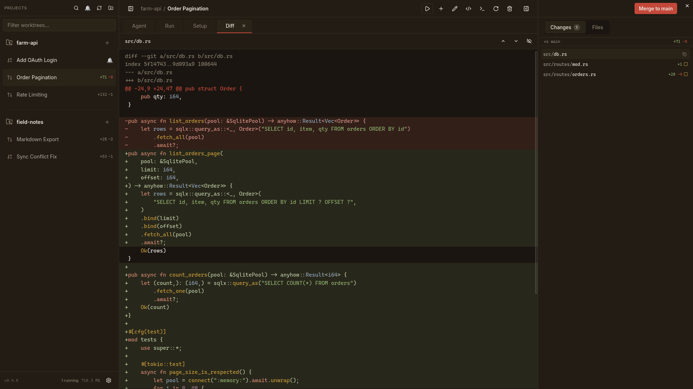
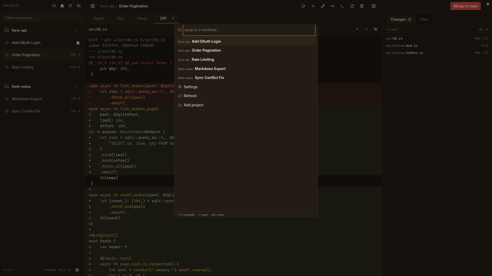

<div align="center">


# corral

[](https://github.com/nnthnn/corral/actions/workflows/ci.yml)

</div>

A Linux-native desktop app for running multiple parallel coding-agent sessions,
each isolated in its own git worktree. Every session gets its own worktree,
branch, and PTY, so several agents can work at once without stepping on each
other. Claude Code, OpenCode, and Pi are all supported.


> Worktrees live at `<worktrees_root>/<project>/<feature>` on branch
> `feat/<feature>`. The root defaults to `~/corral` and is configurable.

## Demo

Search with `Ctrl+K` to jump between worktrees, then click a changed file to
review its diff.


## Screenshots

| Review a branch diff | Jump between worktrees |
| :---: | :---: |
| [](docs/assets/corral-diff.png) | [](docs/assets/corral-command-palette.png) |

<sub>Screenshots use a throwaway demo project.</sub>

## Install

Download the latest `.deb`, `.rpm`, or `.AppImage` from the
[Releases](https://github.com/nnthnn/corral/releases) page.

## Layout

```
corral/
├── Cargo.toml            # workspace
├── crates/
│   ├── corral-core/      # shared lib: worktrees, git, merge/PR, agent sessions, settings
│   └── corral-cli/       # the `corral` CLI binary
├── src-tauri/            # Tauri v2 desktop app (uses corral-core)
└── src/ + index.html     # React 19 + Zustand + Tailwind v4 frontend (Vite)
```

## Develop

Requirements: Rust, Node + pnpm, and the Linux WebKitGTK stack
(`webkit2gtk-4.1`, `libsoup-3.0`). `git`, your agent CLI (`claude` and/or
`opencode`), `gh` (for PRs), and `zeditor` (Zed's CLI) should be on PATH.

```fish
pnpm install        # frontend deps + Tauri CLI
just run            # build the frontend once, then run the desktop app
```

`just --list` shows the full task set (builds, checks, tests, formatting).
Prefer `just run` over `pnpm tauri dev`: the dev server leaves the terminal in
the DEC line-drawing charset on exit, so typing afterwards comes out as
gibberish.

## CLI

```fish
cargo run -p corral-cli -- list           # or build & use `corral` directly
corral new <project> <feature>            # create worktree + launch the agent
corral new <project> <feature> --no-agent # create worktree only
corral list                               # show all worktrees + git status
corral open <feature>                     # open the worktree in Zed
corral rename "<title>"                   # rename the current worktree (slugified from the title)
corral done <feature>                     # remove worktree + delete branch
corral done <feature> --keep-branch       # remove worktree, keep the branch
corral project add <path>                 # register an existing git repo as a project
corral config get                         # print the resolved worktrees root
corral config set <path>                  # override the worktrees root
corral config reset                       # revert to the default (~/corral)
corral awake -- <command>                 # run a command under a sleep/idle inhibitor
```

`corral awake` is the portable sleep guard agents use for long-running
background work (scans, test suites, dev servers, watchers). It holds
`systemd-inhibit` on Linux, `caffeinate` on macOS, or
`SetThreadExecutionState` on Windows for exactly the wrapped command's
lifetime, so the machine stays awake even if the process outlives the agent
session.

Install the CLI to your PATH:

```fish
cargo install --path crates/corral-cli
```

## Status

Implemented:

- **3-pane shell**: a left sidebar of projects → worktrees, a center pane with
  Agent / Run / Diff / File / PR tabs, and a right **Changes** pane with
  click-to-view diffs against the branch base. Keyboard-driven: `Ctrl+K` opens
  a command palette, `Ctrl+1–9` jumps between worktrees, and `Ctrl+Tab` cycles
  the center-pane tabs.
- **Worktree management** (list / create / rename / remove) across the GUI and
  CLI, with per-worktree git status (branch, ahead/behind, dirty counts),
  per-project provisioning rules (files to copy + a one-shot setup command),
  and a filesystem watcher so changes made outside the GUI show up live.
- **Agent sessions**: run Claude Code, OpenCode, or Pi in a PTY inside a worktree,
  stream it to an embedded xterm.js terminal (scrollback re-attach,
  GPU-rendered), type into it, and stop/restart. Claude Code hooks, OpenCode's
  SSE stream, and Pi's bundled extension report real waiting-vs-working status
  back to the sidebar, an idle timeout auto-stops long-idle sessions, and a
  session auto-resumes its last conversation.
- **Run panel**: a long-lived per-worktree run command (e.g. `pnpm dev`) in
  its own tab, with best-effort auto-detection of the project's dev command.
- **Git/PR integration**: fast-forward merge a worktree's branch into its
  base, or push and open/update a GitHub PR via `gh`, with live CI checks in
  the PR tab.
- **File browsing**: a File tab with image, SVG, and Markdown preview.
- Per-project settings, per-worktree free-text notes, and desktop
  notifications.

See `AGENTS.md` for architecture details.
